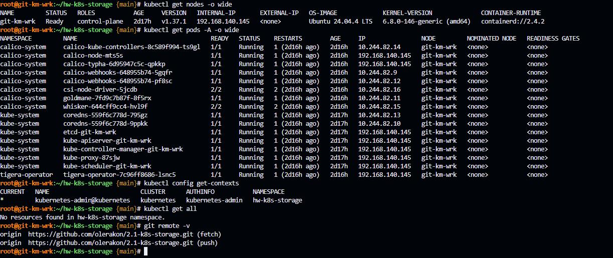
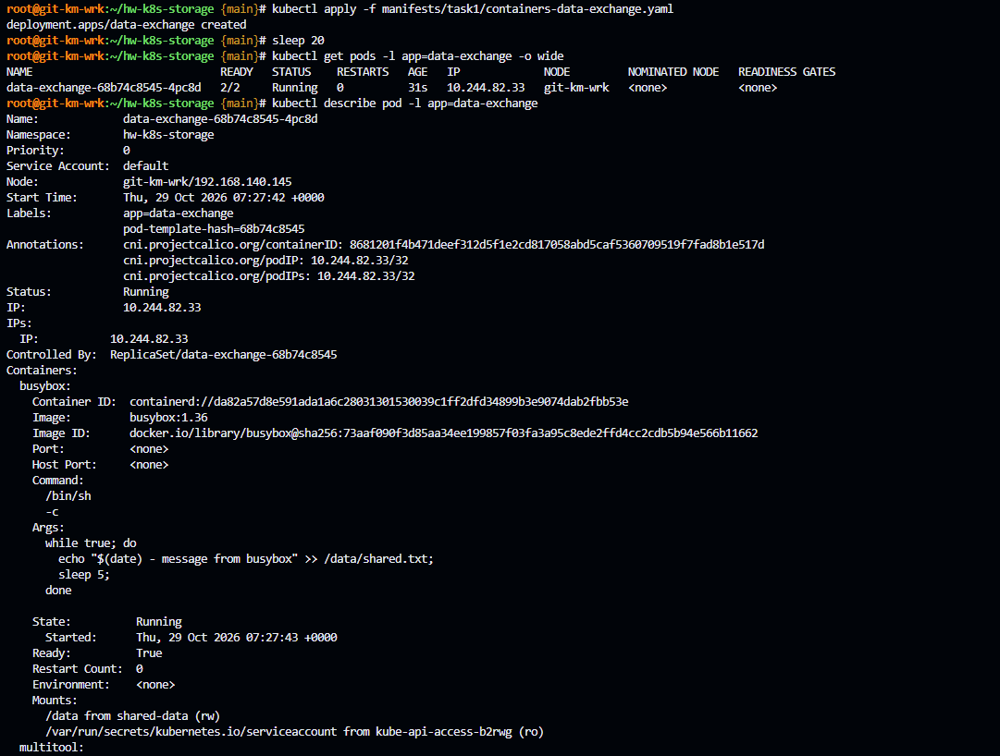
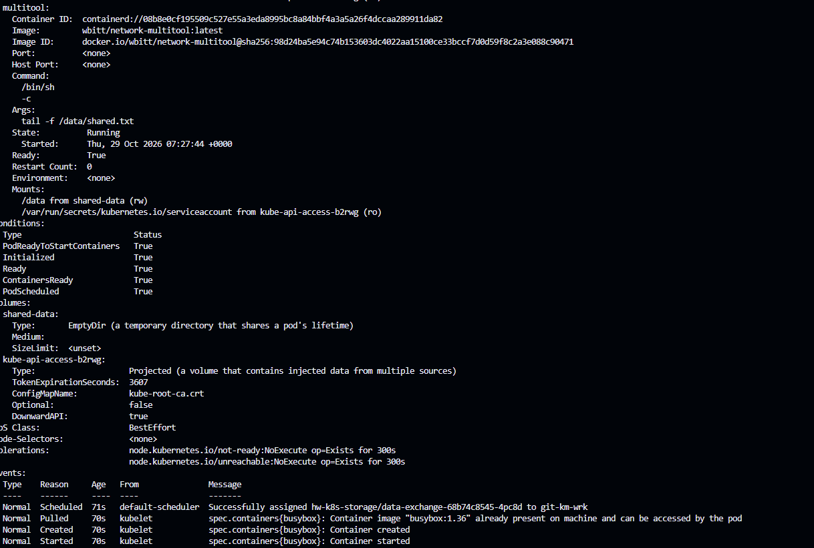
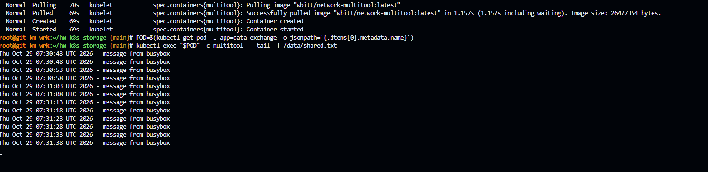
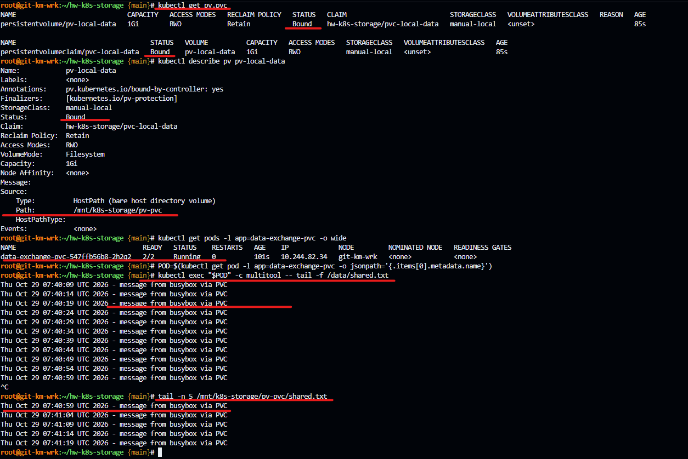
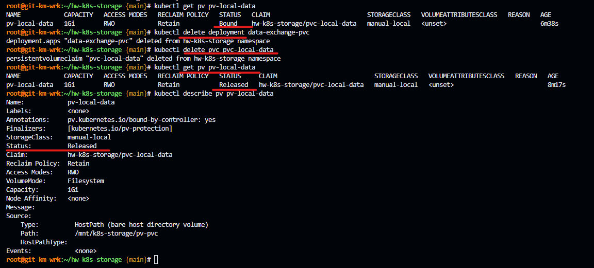
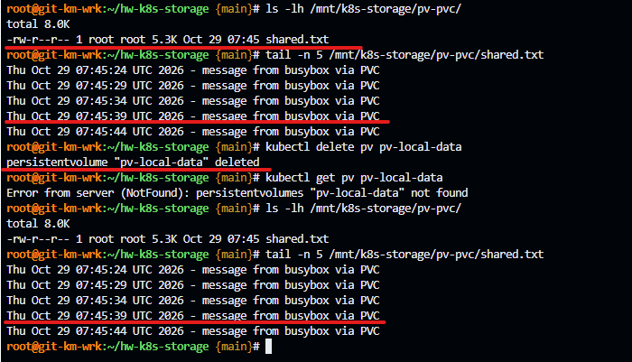
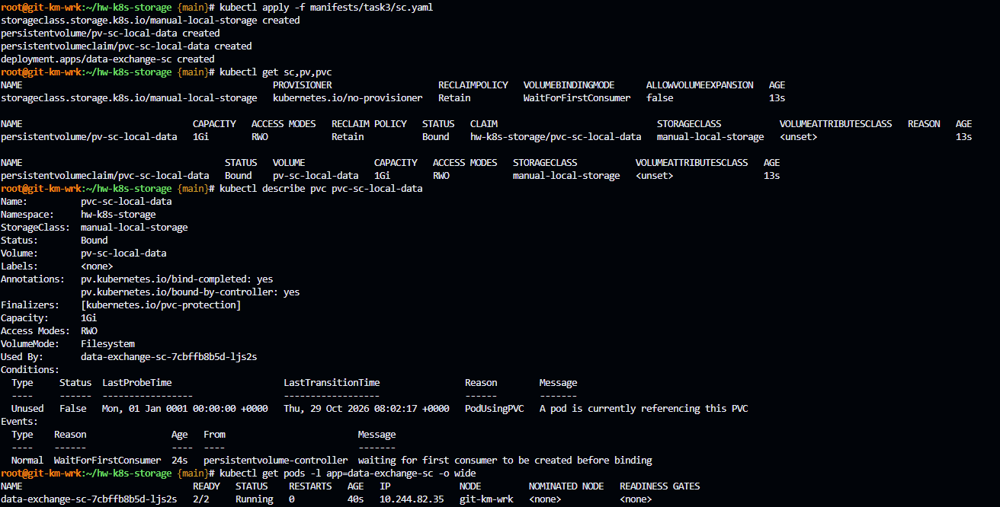
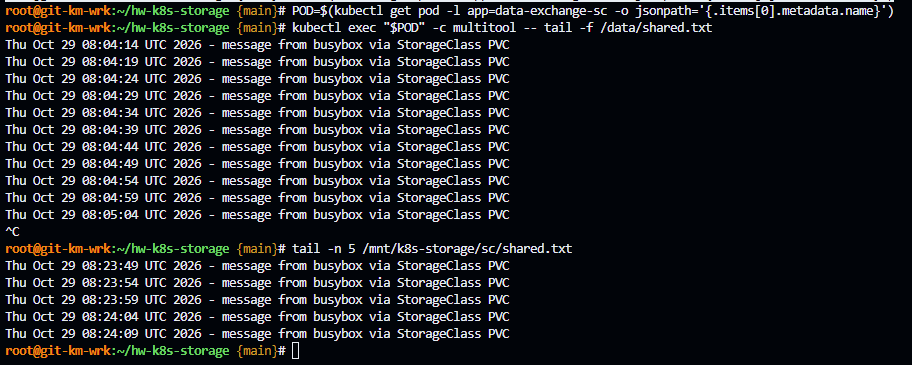

# Домашнее задание к занятию «Хранение в K8s» - `Гилельс Кирилл`

## Предварительная информация

На VM Ubuntu 24.04 LTS был развернут полноценный kubernetes версии 1.37.1 в формате all-in-one-single-node средствами kubeadm.

IP адресс машины 192.168.140.145

В качестве сетевого плагина был выбран calico. Network cidr: 10.244.0.0/16

Так же был инициализирован гит [репозиторий](https://github.com/olerakon/2.1-k8s-storage) проекта 

Для домашнего задания был создан отдельный ns: `hw-k8s-storage` и настроена дефолтная работа в нем через kubectl.

Сводная информация представлена на скриншоте:



Примечание: в моей компании в качестве системы хранилища, используется Longhorn. Позволяет обеспечить реплики,снапшоты и РК в s3 хранилище. 

------

## Задание 1. Volume: обмен данными между контейнерами в поде
### Задача

Создать Deployment приложения, состоящего из двух контейнеров, обменивающихся данными.

### Шаги выполнения
1. Создать Deployment приложения, состоящего из контейнеров busybox и multitool.
2. Настроить busybox на запись данных каждые 5 секунд в некий файл в общей директории.
3. Обеспечить возможность чтения файла контейнером multitool.


### Что сдать на проверку
- Манифесты:
  - `containers-data-exchange.yaml`
- Скриншоты:
  - описание пода с контейнерами (`kubectl describe pods data-exchange`)
  - вывод команды чтения файла (`tail -f <имя общего файла>`)

------

### Решение

Создал [Deployment](./manifests/task1/containers-data-exchange.yaml) приложения, состоящего из двух контейнеров, обменивающихся данными.

1. Создал [Deployment](./manifests/task1/containers-data-exchange.yaml) приложения, состоящего из контейнеров busybox и multitool.
2. Настроил busybox на запись данных каждые 5 секунд в некий файл в общей директории.
```bash
while true; do
                echo "$(date) - message from busybox" >> /data/shared.txt;
                sleep 5;
              done
```
3. Обеспечил возможность чтения файла контейнером multitool.
```yaml
args:
            - tail -f /data/shared.txt
          volumeMounts:
            - name: shared-data
              mountPath: /data
```

- Скриншоты:
  - описание пода с контейнерами (`kubectl describe pods data-exchange`)
  - вывод команды чтения файла (`tail -f <имя общего файла>`)
 






------

## Задание 2. PV, PVC
### Задача
Создать Deployment приложения, использующего локальный PV, созданный вручную.

### Шаги выполнения
1. Создать Deployment приложения, состоящего из контейнеров busybox и multitool, использующего созданный ранее PVC
2. Создать PV и PVC для подключения папки на локальной ноде, которая будет использована в поде.
3. Продемонстрировать, что контейнер multitool может читать данные из файла в смонтированной директории, в который busybox записывает данные каждые 5 секунд. 
4. Удалить Deployment и PVC. Продемонстрировать, что после этого произошло с PV. Пояснить, почему. (Используйте команду `kubectl describe pv`).
5. Продемонстрировать, что файл сохранился на локальном диске ноды. Удалить PV.  Продемонстрировать, что произошло с файлом после удаления PV. Пояснить, почему.


### Что сдать на проверку
- Манифесты:
  - `pv-pvc.yaml`
- Скриншоты:
  - каждый шаг выполнения задания, начиная с шага 2.
- Описания:
  - объяснение наблюдаемого поведения ресурсов в двух последних шагах.

------

### Решение

Создал [Deployment](./manifests/task2/pv-pvc.yaml) приложения, использующего локальный PV, созданный вручную.

1. Создал [Deployment](./manifests/task2/pv-pvc.yaml) приложения, состоящего из контейнеров busybox и multitool, использующего созданный ранее PVC
2. Создал PV и PVC для подключения папки на локальной ноде `/mnt/k8s-storage/pv-pvc`, которая будет использована в поде.
```yaml
apiVersion: v1
kind: PersistentVolume
metadata:
  name: pv-local-data
spec:
  capacity:
    storage: 1Gi
  volumeMode: Filesystem
  accessModes:
    - ReadWriteOnce
  persistentVolumeReclaimPolicy: Retain
  storageClassName: manual-local
  hostPath:
    path: /mnt/k8s-storage/pv-pvc
---
apiVersion: v1
kind: PersistentVolumeClaim
metadata:
  name: pvc-local-data
spec:
  volumeName: pv-local-data
  storageClassName: manual-local
  volumeMode: Filesystem
  accessModes:
    - ReadWriteOnce
  resources:
    requests:
      storage: 1Gi
---
```
3. Продемонстрировал, что контейнер multitool может читать данные из файла в смонтированной директории, в который busybox записывает данные каждые 5 секунд. 



4. Удалил Deployment и PVC. Продемонстрировал, что после этого произошло с PV. 



Пояснение:  PV остался, но его статус изменился с Bound на Released. У PV задана политика persistentVolumeReclaimPolicy: Retain. При удалении PVC Kubernetes не удаляет PV и данные; PV переходит в Released, потому что прежний claim удалён, но данные ещё остаются и том нельзя автоматически отдать новому PVC.

5. Продемонстрировал, что файл сохранился на локальном диске ноды. Удалил PV.  Продемонстрировал, что произошло с файлом после удаления PV.



Пояснение: удаление объекта PV удаляет только Kubernetes-ресурс, описывающий хранилище. Для hostPath фактический каталог и файлы остаются на диске ноды. Kubernetes не удаляет их автоматически. Это соответствует документации: при Retain нужно вручную очищать данные и базовое хранилище.

------


## Задание 3. StorageClass
### Задача
Создать Deployment приложения, использующего PVC, созданный на основе StorageClass.

### Шаги выполнения

1. Создать Deployment приложения, состоящего из контейнеров busybox и multitool, использующего созданный ранее PVC.
2. Создать SC и PVC для подключения папки на локальной ноде, которая будет использована в поде.
3. Продемонстрировать, что контейнер multitool может читать данные из файла в смонтированной директории, в который busybox записывает данные каждые 5 секунд.

### Что сдать на проверку
- Манифесты:
  - `sc.yaml`
- Скриншоты:
  - каждый шаг выполнения задания, начиная с шага 2

------

### Решение 

Создал [Deployment](./manifests/task3/sc.yaml) приложения, использующего PVC, созданный на основе StorageClass.

1. Создал [Deployment](./manifests/task3/sc.yaml) приложения, состоящего из контейнеров busybox и multitool, использующего созданный ранее PVC.
2. Создал SC и PVC для подключения папки `/mnt/k8s-storage/sc` на локальной ноде, которая будет использована в поде.
```yaml
apiVersion: storage.k8s.io/v1
kind: StorageClass
metadata:
  name: manual-local-storage
provisioner: kubernetes.io/no-provisioner #Означает статическое выделение: PV создается вручную
reclaimPolicy: Retain
volumeBindingMode: WaitForFirstConsumer #Задерживает привязку PVC до появления Pod, который его использует.
---
apiVersion: v1
kind: PersistentVolume
metadata:
  name: pv-sc-local-data
spec:
  capacity:
    storage: 1Gi
  volumeMode: Filesystem
  accessModes:
    - ReadWriteOnce
  persistentVolumeReclaimPolicy: Retain
  storageClassName: manual-local-storage
  hostPath:
    path: /mnt/k8s-storage/sc
---
apiVersion: v1
kind: PersistentVolumeClaim
metadata:
  name: pvc-sc-local-data
spec:
  storageClassName: manual-local-storage
  volumeMode: Filesystem
  accessModes:
    - ReadWriteOnce
  resources:
    requests:
      storage: 1Gi
---
```
3. Продемонстрировал, что контейнер multitool может читать данные из файла в смонтированной директории, в который busybox записывает данные каждые 5 секунд.





------
